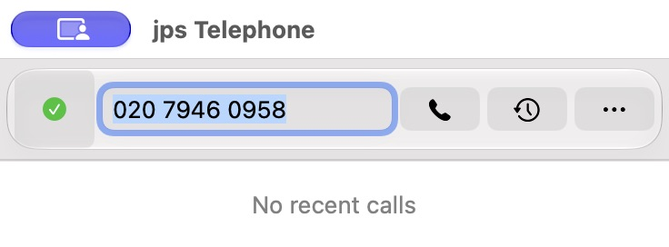
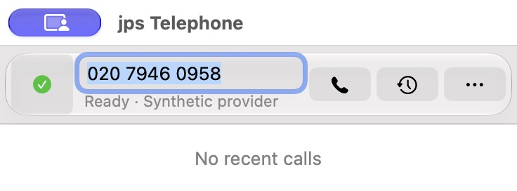
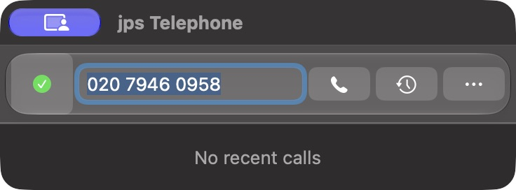
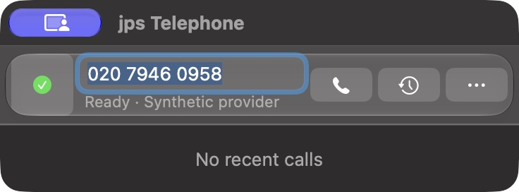

# Compact dialler alignment regression: 3.5 versus 3.6

Fresh screenshot comparison on 21 October 2026 confirms that **3.6 moves the number field 8 points above the Call/History button centre line**. In 3.5 they share a centre line. The permanent route-status line creates a two-line destination block beside single-line centred controls. Content size remains 368 × 104 points in both versions.

The owner reported that 3.6 looked “off kilter” and then said, “I don't see the benefit of the route status line”. Preferred resolution: remove that permanent line and restore the 3.5 alignment. This is a bug report and plan; no application fix has been made.

## Fresh screenshots

| Step | Capture and result | 3.5 baseline | 3.6 regression |
| --- | --- | --- | --- |
| 1 | Light, same synthetic number, active field, Online account and empty history: alignment regresses |  |  |
| 2 | Dark, matching state: same alignment regression |  |  |

Screenshots are unedited 736 × 272 pixel native window captures at 2× scale, including the 32-point titlebar. Main content is 368 × 104 points. Only synthetic data is included.

## Measurements and cause

Native AppKit coordinates are relative to contentView with origin at bottom left:

| Measurement | 3.5/build 162 | 3.6/build 164 |
| --- | ---: | ---: |
| Number field centre Y | 76 pt | 84 pt |
| Call/History button centre Y | 76 pt | 76 pt |
| Number versus button offset | 0 pt | 8 pt upwards |
| Number field size | 160 × 24 pt | 160 × 24 pt |
| Call/History target size | 44 × 44 pt | 44 × 44 pt |
| Main content size | 368 × 104 pt | 368 × 104 pt |

At release source `7abcede`, `Telephone/ActiveAccountViewController.m:184–238` wraps the 24-point field in a 44-point destination view, pins it 2 points below the top, then adds a 13-point route label with a 1-point gap. At 3.5 source `cbfd3a0`, the field is directly centred in the horizontal row. `Telephone/SharedDialerController.m:43–60,103–106` keeps the same window and dialler-region geometry. No material/titlebar layout change was found in this range.

Size/containment tests could therefore pass while visual alignment regressed. Source and native measurements corroborate the fresh screenshots. The comparison does not establish that macOS itself caused the regression.

## Priority

**P2 visual regression.** High everyday benefit, small expected fix. Recommended approach: benefit 4/5, effort 1/5. Address before adding more compact-dialler UI; this report does not resume the deferred roadmap or authorise implementation.

## Two fixes

### A — Remove the permanent route line and restore the 3.5 row (recommended)

1. Remove the route label and the always-two-line destination wrapper. Restore the field as a directly centred item in the existing icon row.
2. Retain the route resolver and selected-provider detail in the Call tooltip and accessibility help; preserve pre-call validation and the existing failure flow. Do not alter provider selection or add fallback calling.
3. Keep waiting-call visibility/cancellation only when requests actually exist. Place the conditional Waiting control independently of the number field, in the available lower dialler space or an unobtrusive badge opening the existing native popover. Verify bounds and focus order before selecting placement.
4. Preserve 368 × 104 content, 44-point targets, recent history, More and all keyboard actions.

**Expected effort:** roughly half a day, subject to the conditional Waiting placement check. **Trade-off:** ready-provider details require hover or accessibility help, matching the owner's preference for a cleaner default interface.

### B — Restore the row and show route feedback only for a problem

1. Use the centred 3.5 row for empty/ready destinations. Do not show permanent “Enter a number” or “Ready” text.
2. For invalid, blocked, disabled or offline routes, expose a concise warning through an accessible status affordance/native popover or the existing error flow. Anchor it independently so it never pushes the number field upward.
3. Keep route details and Waiting actions available; ensure availability changes are announced meaningfully without repeated announcements on every keystroke.
4. Add an explicit state/layout contract so optional feedback cannot silently change primary-row geometry.

**Expected effort:** roughly one to two days. **Trade-off:** more state, focus and announcement testing, but useful guidance appears at the moment it is needed.

## Verification plan for the eventual fix

- Capture matched before/after Light and Dark screenshots at default width with empty/typed/contact-token destinations; assert that field and icon centre Y agree.
- Check focused/unfocused, short/long provider text, ready/offline/disabled/blocked/invalid routes and Waiting 0/1/multiple. Status changes must not move the primary row.
- Check conditional Waiting count and individual stable-ID cancellation, shared expiry, popover focus and keyboard traversal.
- Check compact/expanded history, More and window reopen/restoration; retain 368 × 104 compact content and 44-point targets.
- Check Reduce Transparency, Increase Contrast, supported older macOS fallback and proficient VoiceOver separately. Tooltips alone must not be the only accessible access to route details.
- Keep real provider/audio/permission acceptance separate from visual and synthetic proof.

## Capture method and limits

Actual released 3.5 and 3.6 controller/nib implementations were shown in disposable, uniquely identified, nib-free copies. A small external fixture supplies only an inert synthetic Online account, `020 7946 0958`, empty history and isolated route defaults. Contacts tokenisation and call dispatch are disabled in the fixture. Normal AppController/CompositionRoot startup is skipped so owner data and real SIP accounts are not loaded. The 3.5 ZIP SHA-256 matches the private release asset; the 3.6 copy came from the verified installed release. For each copy, 46 file-backed Mach-O sections, 54 other regular files and six symlinks match the corresponding original. Only fixture metadata and signature material differ.

These are fresh onscreen captures, rather than cached NSView renders. The measured state is recorded in [evidence.json](evidence.json). The owner's original 3.6 window was also inspected locally, but its private contact/history screenshot is excluded from GitHub evidence. No application source, owner preferences, credentials, installed app, release tags or assets were changed. This is not full Settings/call-card or proficient VoiceOver acceptance.

## Official references checked on 21 October 2026

- [Apple layout guidance](https://developer.apple.com/design/human-interface-guidelines/layout): align related controls deliberately and keep adaptable layouts consistent. The 8-point measurement is this app's evidence, not an Apple-prescribed spacing rule.
- [Apple macOS 27 release notes](https://developer.apple.com/documentation/macos-release-notes/macos-27-release-notes): AppKit compatibility review. The documented segmented-cell fixes do not establish a cause for this token-field layout regression.
- [OpenAI Codex best practices](https://learn.chatgpt.com/docs/learn/best-practices): scoped changes, source context and explicit completion checks. This is implementation-process guidance; Telephone has no OpenAI runtime dependency for this feature.

Related: roadmap #52, route presentation #55/#59, waiting-call controls #58, practical acceptance #62.
