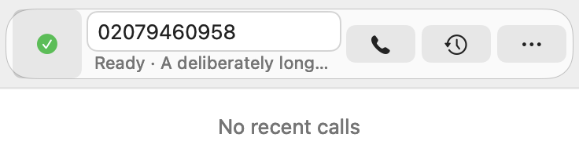
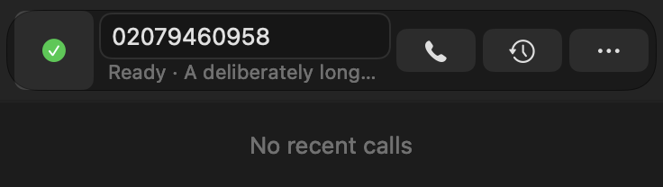

# Selected outgoing connection — issue #55

The source implementation adds a native route-status line inside the compact
dialler's existing destination area. It shows Ready, Waiting, Offline, Disabled
or unavailable before the selected account name; blocked/invalid destinations
have an explanation. Full text remains in the tooltip and on the native
accessibility element. Destination, saved-plan and account changes refresh the
status without making a call.

The overall Online indicator still describes account availability. A different
account being Online no longer hides that the selected outgoing connection is
Offline. Resolution, immutable account selection, call/history ownership and
the no-fallback policy are unchanged. Compact minimums remain 368 × 104 points
and 368 × 268 with history expanded; existing hit targets remain 44 points.

## Verification — 19 October 2026

All four local suites passed **667 test cases, zero failures**: Domain 28 XCTest;
UseCases 201 XCTest + 131 Swift Testing; ReceiptValidation 5 XCTest; isolated
Telephone 254 XCTest + 48 Swift Testing. The two new native regressions check
selected Offline B while A is Online, state transitions, saved-plan boundaries,
destination/account changes, blocked/invalid input, native accessibility and
compact sizing. The [JSON record](issue-55-verification.json) binds source input
and log hashes to the results.

The initial raw-input fixture unexpectedly reached legacy Contacts
authorisation. It is diagnostic evidence, not accepted isolation proof. The
corrected fixtures detach the tokenisation delegate, use synthetic account data
and unique defaults, and were rerun under fresh nib-free Debug identities. No
permission was granted by the agent. The final full app run and its captures use
the corrected fixtures.

Dependency/vendor, inert audio-device, synthetic recording, Foundation,
audio-integration and recording-model checks also passed. Their component/model
results are separate from the 667 test cases. These are not real SIP/provider,
physical-audio or proficient VoiceOver speech results.

The Light/Dark captures below were inspected at the unchanged compact size;
their recorded hashes match the final run's images. They use synthetic names,
numbers and empty history.

## Delivery boundary

The owner chose **commit each verified fix; release after the roadmap**. This
change is source-only. Version metadata, the installed 3.5.1/build 163 app,
release tags and uploaded assets remain unchanged. No per-fix package,
installation or publication is claimed.

- [Issue #55](https://github.com/jpskidmore/telephone-jps/issues/55) and
  [ranked roadmap](https://github.com/jpskidmore/telephone-jps/issues/52).
- [OpenAI Codex best practices](https://learn.chatgpt.com/guides/best-practices)
  — scoped implementation and explicit completion checks.
- [Apple macOS 27 release notes](https://developer.apple.com/documentation/macos-release-notes/macos-27-release-notes)
  — SDK/OS compatibility; older supported-OS fallbacks remain unchanged.
- [Apple NSAccessibilityProtocol](https://developer.apple.com/documentation/appkit/nsaccessibilityprotocol)
  — full informational text on the actual native accessibility element.
