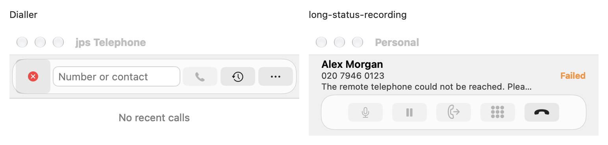
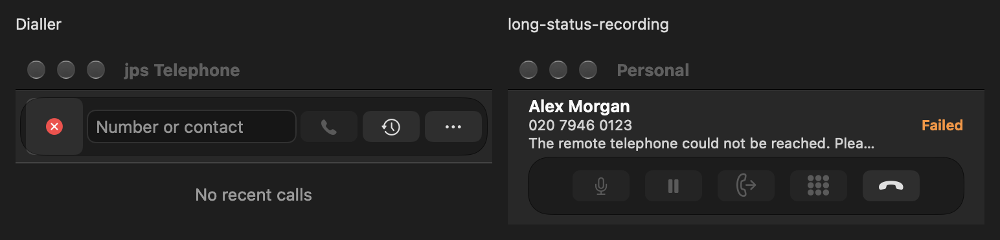

# Call-window footprint — issue #74

Date: 28 October 2026. Source base: `56d8ebf309d1a2821ce46428dbe6309030e98dad`.

The normal call window now uses the existing default compact dialler's **368 × 104 point content size**. An actual native `SharedDialerController` reference and the call window both measured **368 × 136 points including the native titlebar** on this Mac. The shared contract covers initial nib load, legacy saved call frames, ringing, calling, connecting, active and ended states. Long status messages, recording preparation/failure/capture and a long call duration retain the same footprint.

This matches the standard compact dialler. Manually resized or expanded-history dialler windows and dedicated transfer sheets are outside this contract. Frame normalisation preserves the call window's horizontal position and top edge away from screen bounds; screen-safety clamping may move its origin without changing its compact size.

The status label uses one bounded line with tail truncation. Its full text remains available through the tooltip and accessibility value. The native tests retain meaningful checks for the 44-point call action hit targets, spacing, containment, physical hit-testing, native chrome, keyboard handling and action dispatch. They also check that status text cannot overlap the action bar.

## Verification

Fresh local validation passed with zero failures:

- 50 focused native tests: 18 call-control presentation, 17 compact-call card and 15 recording-feedback cases.
- 968 full-suite cases: Domain 28 XCTest; UseCases 206 XCTest + 147 Swift Testing; ReceiptValidation 5 XCTest; Telephone 534 XCTest + 48 Swift Testing.
- The separate recording hardening harness passed 105 ownership assertions. The 50-item repair gate, dependency/vendor checks and unsigned Release build passed.

Validation used Xcode 27.1 (27A9275), macOS 27.2 (26B123), arm64, and a local isolated unique-identity nib-free native host. Synthetic factories and call snapshots avoided real account/profile restoration and provider calls. The full validation artifacts are retained locally at `/private/tmp/jps-telephone-validation.Y1RonJ`.

All nine runtime/test input hashes still match the frozen tested-input manifest. The companion [JSON evidence](2026-10-28-call-window-footprint.json) records those source hashes, all three build/test log hashes, all 10 PNG/10 geometry JSON capture hashes, and the representative committed image hashes.

All 10 native side-by-side Light/Dark captures were visually inspected, covering incoming, connecting, active, long recording error and ended states. Each geometry attachment reports matching 368 × 136 outer and 368 × 104 content frames at backing scale 2. These captures include actual native theme frames and titlebars; the dialler is on the left and the call window on the right.

## Acceptance limits

The owner's deferred real acceptance matrix in [#62](https://github.com/jpskidmore/telephone-jps/issues/62) remains pending. Local synthetic checks do not establish real provider/hardware/audio/recording playback, permission grants, profile/Keychain/Contacts, sleep/wake, actual VoiceOver use or other display arrangements. Full tooltip/accessibility-value assertions verify the supplied text, not a completed real VoiceOver session.

This evidence covers the source change and local validation. It does not install the app or publish a new release; existing immutable releases and assets remain unchanged.
