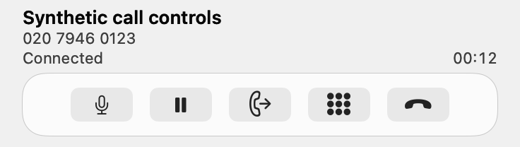
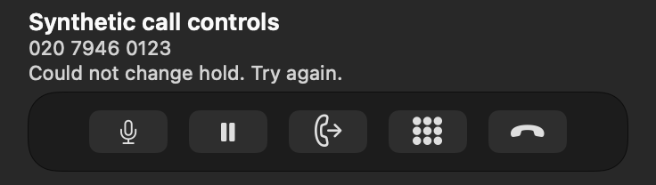
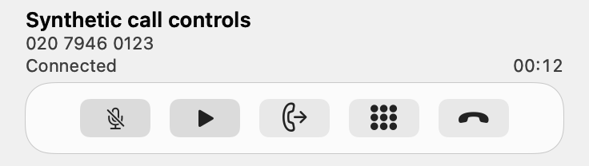
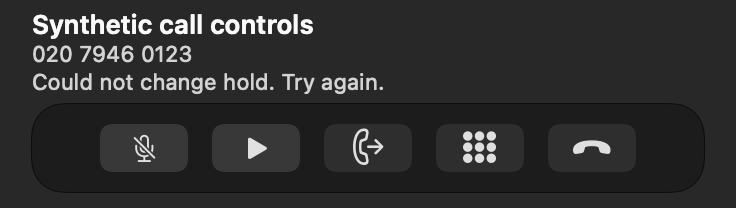
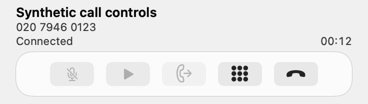
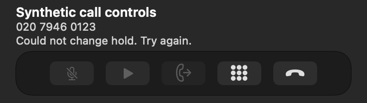

# Persistent call-control icons — issue #76

Source repair verified on 4 November 2026, based on main `8e2d1ea` after published 3.8/build 167. This is not an installation or a new release. [Issue #76](https://github.com/jpskidmore/telephone-jps/issues/76) remains open for installed live-call acceptance; parent #62 retains the practical checks.

## Cause and change

A native AppKit probe on macOS 27.2 reproduced `NSButton.title` changing `imagePosition` from `NSImageOnly` (1) to leading (6), even with a symbol already assigned. `refreshControlPresentation` updates Mute/Unmute and Hold/Resume titles but previously did not restore icon-only layout. The repair restores `NSImageOnly` after title updates, only when necessary. Titles, tooltips, accessibility labels, state, enabled rules, actions and compact geometry retain their existing semantics. No SIP or audio code changed.

## Fresh validation

- New real-nib regression `testMuteAndHoldKeepIconsThroughTitleAndLifecycleChangesInBothAppearances`: original source failed with **42 image-position assertions**; repaired source passed. It checks images, 44 × 44 point hit frames, titles/help/accessibility, repeated mute/hold transitions, pending failures, remote hold, disconnect, observation removal and call replacement in Light/Dark.
- Final successful Debug build-for-testing and newly prepared unique-identity, nib-free isolated host: **571 XCTest + 48 Swift Testing = 619 tests**, zero failures. This includes all existing call-control, compact-card, transfer and lifecycle regressions. No production profile or live SIP call was launched.
- Unsigned arm64 Release compilation passed. No package, signing, installation, tag or release publication was performed.
- All six native render attachments below were visually inspected. Icons remain visible in normal, selected and pending/disabled states. These are actual AppKit renders with synthetic calls, not installed-call screenshots or proficient VoiceOver acceptance.

An initial screenshot-helper compile error was corrected before the final successful rebuild. An intermediate run using the older test bundle is excluded from the evidence above. The accepted results are `final-build.log`, `final-test.log` and `release-build.log`; hashes and exact source inputs are in the companion JSON. Other framework suites were not rerun or added to this total.

| State | Light | Dark |
|---|---|---|
| Normal |  |  |
| Muted and held |  |  |
| Pending changes |  |  |

## Remaining acceptance

Verify a separately installed candidate during a controlled consenting live call in both appearances, including mute/unmute, hold/resume and ending while held. The current published 3.8 archive is unchanged and does not contain this repair. Actual provider/audio/hardware and proficient VoiceOver checks remain separate under #62.
