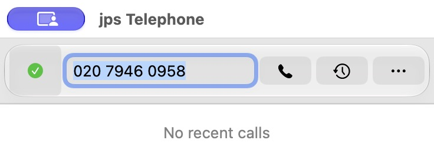
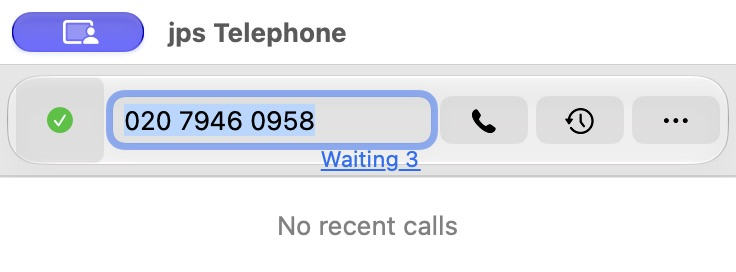
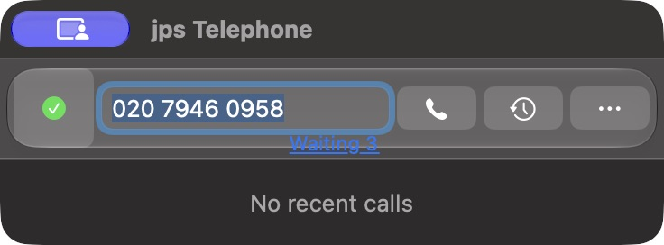

# Completed 3.6.1/build 165 hotfix — 21 October 2026

[GitHub Latest v3.6.1](https://github.com/jpskidmore/telephone-jps/releases/tag/v3.6.1) is installed at `/Applications/jps Telephone.app` from immutable source/tag `407bd1ceb8c39995a986180c8ec70dad87d1a8fc`. Release ID `419312925`. The owner selected Fix A for #72 and explicitly authorised installation and publication. Repository visibility remains public as the owner chose; no visibility setting was changed during this fix.

The number field again shares the 3.5 centre line with Availability, Call, History and More. The permanent route line is removed. Provider details remain in Call tooltip and button/cell accessibility help. Conditional Waiting links remain independently below the field, with the existing native popover and selected-ID cancellation.

## Verified evidence

- **694 fresh local native suite cases passed**, zero failures/skips: Domain 28, UseCases 332, ReceiptValidation 5, Telephone 329. The changed native tests verify Light/Dark centre alignment, fixed field geometry through Waiting 0/1/3/0, every 44-point primary target, full Waiting hit regions including the edge outside glass, focus/key chain and provider help for changed/offline/disabled/removed/blocked/invalid routes.
- Build-script vendor/audio/recording/Foundation checks and all six extra routing/SIP/history/CoreAudio groups passed separately. An initial test-assertion syntax error was corrected before the final clean full pass; failed attempt logs remain local diagnostics.
- Independent source and native visual review passed. Fresh actual-binary synthetic captures verify field/icon centre Y=76 and 368 × 104 content in Light/Dark. CUA opened Waiting3, cancelled the second synthetic request, and retained only the first/third IDs with Waiting 2. The real queue expiry/cancellation fixtures are separately part of the native suite.
- Every **57 regular app file payloads and six symlink targets**, and **1,451 source Git blobs**, match the exact packaged source/build/installed bytes. All four native binaries are arm64, signatures and root/XPC sandbox entitlements passed, and production MainMenu metadata remains intact.
- All **seven downloaded release assets** match their local sizes and SHA-256 values. All six releases and 37 asset records visible in the pre-release snapshot and all eleven distinct prior tags/twelve ref records remain unchanged. Historical 3.6 proof retains its earlier snapshot counts; these current checks do not infer missing history from a different API snapshot.
- Previous installed3.6 is preserved in a durable backup ZIP recorded in the JSON proof, with staged installation and rollback. Owner settings, Keychain credentials, history and recordings were not migrated. Upstream Telephone1.6 remains unchanged.
- All builds/tests were local. No workflow was manually dispatched. GitHub automatic security/CodeQL checks are recorded separately; `[skip ci]` does not suppress every dynamic security run. Security and visibility settings were left alone.

[Machine-readable publication proof](3.6.1-verification.json), [test results](3.6.1-tests.json), [native geometry](3.6.1-screenshots/geometry.json).

| Capture | Light | Dark |
| --- | --- | --- |
| Centred row, no permanent status |  |  |
| Conditional waiting feedback |  |  |

[After individual cancellation](3.6.1-screenshots/06-after-individual-cancellation.jpg). Captures use isolated uniquely identified nib-free copies of the actual signed release with synthetic display data and inert dispatch; no owner profile is loaded by those fixtures. A cropped popover capture was rejected and is excluded from accepted evidence.

Ad-hoc signed and unnotarised. These source/package/visual checks do not prove real provider/audio/device, actual permission grants, full contrast or proficient VoiceOver acceptance. Other roadmap #61–71 remains deferred. Later documentation commits do not rewrite the release tag or assets.

Official references checked21 October: [Apple macOS27 notes](https://developer.apple.com/documentation/macos-release-notes/macos-27-release-notes), [Apple layout](https://developer.apple.com/design/human-interface-guidelines/layout), [OpenAI best practices](https://learn.chatgpt.com/docs/learn/best-practices).
